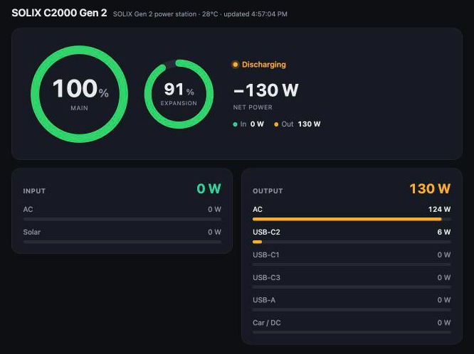

# ank-pwr-bt

See and monitor Anker SOLIX power stations straight from Chrome over Web
Bluetooth. No app or cloud account needed.



## Use it

Open **https://permutation-limited.github.io/ank-pwr-bt/** in Chrome or Edge
(desktop or Android; Safari, iOS and Firefox don't support Web Bluetooth) and
click **Connect**. Everything runs in your browser: there's no server, and
your device's data never leaves your machine.

The power station accepts one Bluetooth connection at a time, so close the
Anker app on your phone (or turn off its Bluetooth) first. If the station asks
you to approve the browser, short-press its power or IoT button.

- **Status** (`#/`): battery level and power in and out, live.
- **Debug** (`#/debug`): session details, raw telemetry tags, advertisements,
  the GATT tree and a protocol log.

## Develop

You only need Bazel (via bazelisk). Bazel fetches Node.js, TypeScript, esbuild
and the npm packages pinned in `pnpm-lock.yaml`.

```bash
bazel run //web:serve          # http://localhost:8080 (ibazel run //web:serve to rebuild on edit)
bazel test //...               # type-check, protocol, device model and layering tests
bazel build //web:dist         # deployable site in bazel-bin/web/dist
```

After editing `package.json`, refresh the lockfile with Bazel's pinned pnpm:

```bash
bazel run -- @pnpm --dir $PWD install --lockfile-only
```

Every push to `main` is tested, built and deployed to GitHub Pages by
`.github/workflows/pages.yml`.

## How it works

The SOLIX Bluetooth protocol (framing, P-256 ECDH, AES-CBC/GCM) is ported from
[SolixBLE](https://github.com/flip-dots/SolixBLE). The code is in three layers,
each depending only on the one below. `web/src/architecture.test.ts` enforces this:

| Layer | Path | Role |
| --- | --- | --- |
| Protocol | `web/src/protocol/` | Framing, crypto, handshake, device models. No DOM or Web Bluetooth. |
| BLE client | `web/src/ble/` | `SolixClient`: connection, handshake retries, typed events. No DOM. |
| UI | `web/src/ui/` | React + MUI status and debug pages, rendered from client events. |

**Device models** (`web/src/protocol/models/`) hold everything model-specific:
how to recognize the device, its handshake, its start-up commands and its
telemetry decoder. Each decoded field has a role (battery, input, output and so
on), so the status page works for any model. Unrecognized SOLIX devices still
connect and show raw data on `/debug`.

| Model | Devices |
| --- | --- |
| `solix-gen2` | C1000 / C1000X Gen 2, C1000 Plus, C2000 Gen 2 (tested) |
| `solix-generic` | Any other SOLIX device (raw data only) |

To add a device, write a `DeviceModel` and register it in
`protocol/models/index.ts`. SolixBLE's `devices/*.py` field maps port over
directly.

## License and disclaimer

Copyright © 2026 Permutation Limited. Released under the [MIT License](LICENSE).
The protocol implementation is ported from SolixBLE (MIT); see
[THIRD_PARTY_NOTICES.md](THIRD_PARTY_NOTICES.md).

This is an independent project. It is not affiliated with, endorsed by or
sponsored by Anker Innovations. Anker and SOLIX are trademarks of Anker
Innovations Limited, used here only to identify compatible devices. The
Bluetooth protocol was reverse-engineered by the community and may change
with firmware updates. Use at your own risk.
